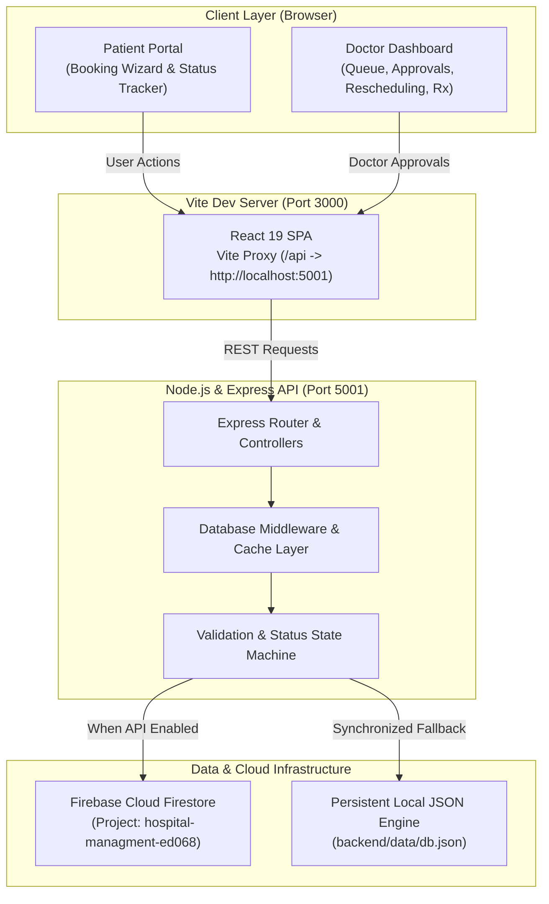
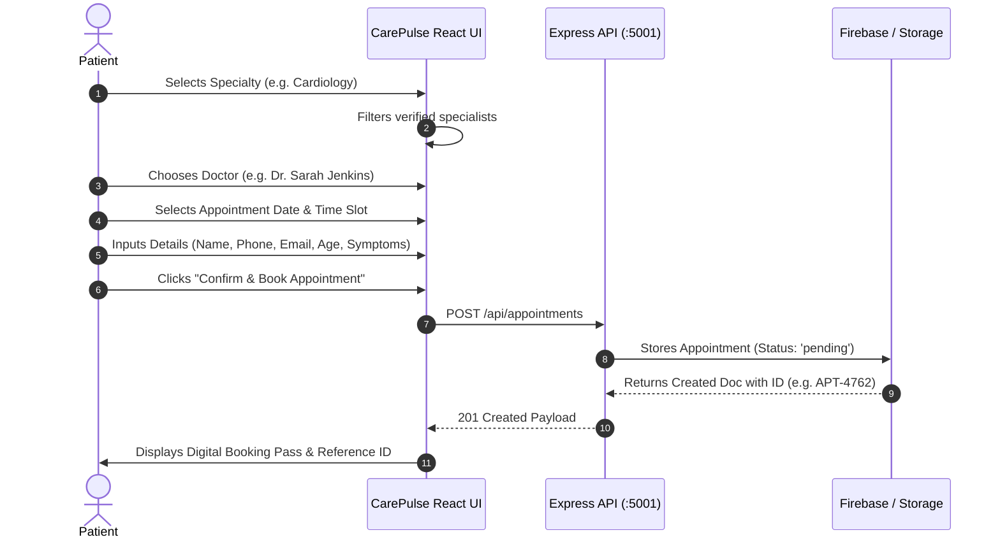
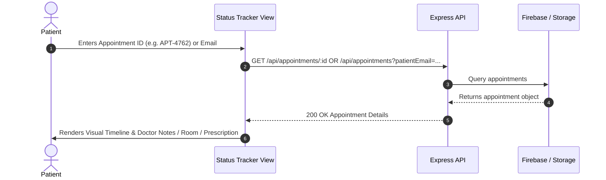
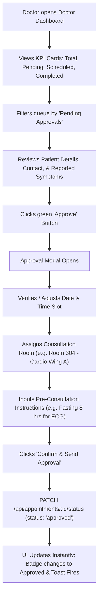

# 🏥 CarePulse — Hospital Management & Appointment Scheduling System

[](https://reactjs.org/)
[](https://nodejs.org/)
[](https://expressjs.com/)
[](https://firebase.google.com/)
[](https://vitejs.dev/)

An enterprise-grade, full-stack Hospital Management & Appointment Scheduling Platform that bridges the gap between healthcare seekers and medical specialists. Clients can seamlessly book appointments with board-certified doctors, track real-time clinical review status, and receive digital passes. Doctors have a dedicated management suite to approve, reschedule, manage queues, and issue medical prescriptions.

---

## 📑 Table of Contents

1. [System Architecture](#-system-architecture)
2. [End-to-End User Flows](#-end-to-end-user-flows)
   - [Patient Booking Flow](#1-patient-booking-flow)
   - [Patient Real-Time Tracking Flow](#2-patient-real-time-tracking-flow)
   - [Doctor & Staff Approval Workflow](#3-doctor--staff-approval-workflow)
   - [Doctor Rescheduling Workflow](#4-doctor-rescheduling-workflow)
   - [Consultation & Prescription Workflow](#5-consultation--prescription-workflow)
3. [Key Features](#-key-features)
4. [Tech Stack](#-tech-stack)
5. [Project Directory Structure](#-project-directory-structure)
6. [Firebase Database Configuration](#-firebase-database-configuration)
   - [Service Account Details](#service-account-details)
   - [Dual-Mode Cloud/Sync Storage Engine](#dual-mode-cloudsync-storage-engine)
   - [Enabling Firestore in Firebase Console](#enabling-firestore-in-firebase-console)
7. [API Specification & Documentation](#-api-specification--documentation)
8. [Installation & Setup Guide](#-installation--setup-guide)
9. [Troubleshooting & FAQ](#-troubleshooting--faq)

---

## 🏛 System Architecture

The following diagram outlines the interaction between the React frontend, the Express backend, and the Firebase Firestore database layer:



---

## 🔄 End-to-End User Flows

### 1. Patient Booking Flow



#### Detailed Booking Steps:
1. **Step 1: Specialty & Doctor Selection**:
   - Filter by 9 hospital wings: Cardiology, Neurology, Pediatrics, Orthopedics, Dermatology, General Medicine, Ophthalmology, Oncology, Gynecology.
   - Doctor cards show degrees, clinical experience (years), patient rating stars, reviews count, and consultation fees.
2. **Step 2: Date & Consultation Slot Selection**:
   - Date picker restricts past dates (tomorrow onwards).
   - Dynamic consultation time chips (e.g., `09:00 AM`, `10:30 AM`, `02:00 PM`) based on doctor availability.
3. **Step 3: Patient Demographics & Health Profile**:
   - Patient Name, Email Address, Contact Phone Number.
   - Age, Gender (Female, Male, Non-Binary, Other).
   - Chief health complaint / symptoms description.
4. **Step 4: Digital Booking Pass**:
   - Generates unique reference ID (`APT-XXXX`).
   - Printable pass with doctor name, department, consultation fee, and pending status.
   - 1-click button to track status or copy reference code.

---

### 2. Patient Real-Time Tracking Flow



- **Status Progression States**:
  - `pending`: Awaiting doctor review.
  - `approved`: Doctor confirmed date, time slot, and assigned consultation room.
  - `rescheduled`: Doctor shifted timing with reason provided.
  - `completed`: Consultation finished, diagnosis & prescription medication visible.
  - `rejected` / `cancelled`: Declined with doctor explanation.

---

### 3. Doctor & Staff Approval Workflow



---

### 4. Doctor Rescheduling Workflow

When emergencies arise or clinic hours change:
1. Doctor clicks **"Reschedule"** on any pending or approved appointment.
2. Selects a new consultation date and available time slot.
3. Enters an explanation note (e.g., *"Shifted due to emergency surgical rounds"*).
4. Submits request via `PATCH /api/appointments/:id/reschedule`.
5. Status updates to `rescheduled`, and the patient sees the updated date, time, and doctor explanation immediately on the tracking portal.

---

### 5. Consultation & Prescription Workflow

Once the patient arrives and completes the clinical visit:
1. Doctor clicks **"Complete & Rx"**.
2. Records **Doctor Clinical Notes / Diagnosis** (e.g. *"Normal sinus rhythm, mild stress-induced palpitations"*).
3. Writes **Prescription & Medical Recommendations** (e.g. *"Rx: Propranolol 10mg PRN, daily hydration > 3L, follow-up in 4 weeks"*).
4. Submits via `PATCH /api/appointments/:id/status` (status: `completed`).
5. The digital pass automatically unlocks the official prescription card for the patient to save or print.

---

## 🌟 Key Features

| Feature | Description |
| :--- | :--- |
| **Interactive Role Switcher** | Seamlessly toggle between **Patient Portal** and **Doctor Dashboard** without page reload. |
| **Multi-Step Booking Wizard** | Fluid 4-step wizard with real-time field validation, date constraints, and instant booking pass generation. |
| **Live Queue & Triage** | Doctors can filter appointments by status (`All`, `Pending`, `Approved`, `Rescheduled`, `Completed`), search by patient name/ID, and view patient symptoms. |
| **Room & Time Scheduling** | Doctors specify exact room locations (e.g., `Room 304 - Cardio Wing A`) and confirmed consultation time slots. |
| **Digital Prescriptions** | In-app clinical findings, prescription notes, and medication guidance. |
| **Live Status Tracker** | Search by Appointment ID or Email to view visual timeline, status badges, and instructions. |
| **Specialist Directory** | Browse doctors across 9 clinical departments with experience, ratings, bios, and fees. |
| **Emergency Support** | 24/7 trauma response helpline, ICU bed status, and hospital services. |
| **Dual Database Engine** | Connects to Firebase Cloud Firestore with automatic local synchronized JSON persistence fallback. |

---

## 🛠 Tech Stack

- **Frontend**:
  - **React 19** (`react`, `react-dom`)
  - **Vite 8** (Lightning-fast dev server with automated reverse proxy)
  - **Lucide Icons** (`lucide-react`)
  - **Custom Vanilla CSS** (Glassmorphism, CSS variables, responsive grid, animations)
  - **Google Fonts** (*Plus Jakarta Sans* & *Outfit*)
- **Backend**:
  - **Node.js** (v22+)
  - **Express 4.21** (RESTful API, middleware, route handling)
  - **CORS** & **Morgan** (Cross-origin support & HTTP request logging)
- **Database & Cloud**:
  - **Firebase Admin SDK 13** (`firebase-admin`)
  - **Google Cloud Firestore** (Project: `hospital-managment-ed068`)
  - **Local Synchronized Storage** (`backend/data/db.json` fallback)

---

## 📂 Project Directory Structure

```
projet hospital management/
├── README.md                      # Comprehensive project documentation & guide
├── package.json                   # Root package script runner
│
├── backend/                       # Node.js + Express + Firebase Backend
│   ├── package.json               # Backend dependencies
│   ├── server.js                  # Main Express app, middleware & routes
│   ├── database.js                # Unified database service (Firestore + local sync)
│   ├── firebase.js                # Firebase Admin SDK initialization
│   ├── serviceAccountKey.json     # Firebase service account credential
│   └── data/
│       └── db.json                # Synchronized local JSON database store
│
└── frontend/                      # React 19 + Vite Frontend SPA
    ├── index.html                 # Main HTML entry with Google Fonts
    ├── package.json               # Frontend dependencies
    ├── vite.config.js             # Vite configuration with /api proxy to port 5001
    └── src/
        ├── main.jsx               # React DOM root mounting
        ├── App.jsx                # Main orchestrator component (role & state management)
        ├── App.css                # Component layouts, cards, tables, steppers
        ├── index.css              # Design system tokens, variables, typography, badges
        └── components/
            ├── Navbar.jsx              # Brand, role switcher, DB status, CTA
            ├── HeroSection.jsx         # Hospital intro, live counters, action buttons
            ├── BookingWizard.jsx       # 4-Step interactive appointment booking
            ├── StatusTracker.jsx       # Live appointment lookup & timeline tracker
            ├── DoctorDashboard.jsx     # Doctor queue, approvals, reschedule & Rx modals
            ├── DoctorsDirectory.jsx    # Specialist directory with specialty filters
            └── HospitalServices.jsx    # 24/7 emergency & trauma facilities
```

---

## 🗄 Firebase Database Configuration

### Service Account Details
The backend is authenticated using the provided service account credentials:
- **Project ID**: `hospital-managment-ed068`
- **Client Email**: `firebase-adminsdk-fbsvc@hospital-managment-ed068.iam.gserviceaccount.com`
- **Private Key ID**: `23d636105468c57836a543ed85a764d0c4d15ba4`
- **Credential File**: [`backend/serviceAccountKey.json`](backend/serviceAccountKey.json)

### Dual-Mode Cloud/Sync Storage Engine
To guarantee zero crashes:
1. **Cloud Firestore Mode**: When Firestore API is enabled on Google Cloud, all appointments, doctors, and departments are written to and read from Firestore collections.
2. **Synchronized Local Fallback Mode**: If the Cloud Firestore API is pending activation in the Google Cloud/Firebase console, the backend automatically uses [`backend/data/db.json`](backend/data/db.json). This allows the entire system to run, book, approve, and reschedule appointments with 100% functionality right out of the box.

### Enabling Firestore in Firebase Console
To activate Cloud Firestore on your project:
1. Open the [Firebase Console](https://console.firebase.google.com/project/hospital-managment-ed068/firestore).
2. Click **Create Database**.
3. Select your preferred database location (e.g., `us-central1` or `asia-south1`) and click **Next**.
4. Choose **Start in test mode** (or production mode) and click **Enable**.
5. Once activated, the backend will automatically recognize Firestore on its next check without requiring code changes!

---

## 📡 API Specification & Documentation

### Base URL: `http://localhost:5001` (or `/api` via Vite proxy)

#### 1. System Health
- **`GET /api/health`**
  - **Response**:
    ```json
    {
      "status": "online",
      "timestamp": "2026-10-16T02:44:43.597Z",
      "firebase": {
        "projectId": "hospital-managment-ed068",
        "serviceAccount": "firebase-adminsdk-fbsvc@hospital-managment-ed068.iam.gserviceaccount.com",
        "firestoreActive": true,
        "mode": "cloud_firestore"
      }
    }
    ```

#### 2. Key Performance Indicators (KPIs)
- **`GET /api/stats`**
  - **Response**:
    ```json
    {
      "totalAppointments": 5,
      "pending": 2,
      "approved": 2,
      "rescheduled": 1,
      "completed": 1,
      "cancelled": 0,
      "totalDoctors": 6,
      "totalDepartments": 9,
      "databaseStatus": "local_synchronized"
    }
    ```

#### 3. Doctors & Departments
- **`GET /api/doctors`** — Returns list of all doctors, ratings, bios, slots, and fees.
- **`GET /api/doctors/:id`** — Returns specific doctor profile.
- **`GET /api/departments`** — Returns list of all 9 medical departments.

#### 4. Appointments Management
- **`GET /api/appointments`**
  - Query parameters: `?doctorId=doc-1&status=pending&patientEmail=user@example.com&date=2026-10-18`
- **`GET /api/appointments/:id`** — Returns appointment by ID (e.g., `APT-1001`).
- **`POST /api/appointments`** — Book a new appointment.
  - **Request Body**:
    ```json
    {
      "patientName": "John Doe",
      "patientEmail": "john.doe@example.com",
      "patientPhone": "+1 (555) 789-0123",
      "patientAge": 35,
      "patientGender": "Male",
      "doctorId": "doc-1",
      "doctorName": "Dr. Sarah Jenkins",
      "department": "Cardiology",
      "reason": "Occasional palpitations during morning exercise.",
      "preferredDate": "2026-10-18",
      "preferredTime": "10:00 AM"
    }
    ```

#### 5. Doctor Actions (Approve, Reschedule, Complete, Notes)
- **`PATCH /api/appointments/:id/status`**
  - **Request Body**:
    ```json
    {
      "status": "approved",
      "scheduledDate": "2026-10-18",
      "scheduledTime": "10:00 AM",
      "room": "Room 304 - Cardio Wing A",
      "doctorNotes": "Approved. Please avoid caffeine 12h prior to visit."
    }
    ```
- **`PATCH /api/appointments/:id/reschedule`**
  - **Request Body**:
    ```json
    {
      "scheduledDate": "2026-10-21",
      "scheduledTime": "02:30 PM",
      "doctorNotes": "Rescheduled due to emergency on-call duty."
    }
    ```
- **`PATCH /api/appointments/:id/notes`**
  - **Request Body**:
    ```json
    {
      "doctorNotes": "ECG completed. Normal sinus rhythm.",
      "prescription": "Rx: Aspirin 81mg OD x 30 days. Maintain regular hydration."
    }
    ```

---

## 💻 Installation & Setup Guide

### Prerequisites
- [Node.js](https://nodejs.org/) v18.0.0 or higher
- [npm](https://www.npmjs.com/) v9.0.0 or higher

### Quick Start (Two Terminals)

#### Terminal 1: Start Backend Server
```bash
cd backend
npm install
npm run dev
```
*Backend server will listen on `http://localhost:5001`.*

#### Terminal 2: Start Frontend Application
```bash
cd frontend
npm install
npm run dev
```
*Frontend application will start on `http://localhost:3000`.*

Open your browser and navigate to **`http://localhost:3000`**.

---

## ❓ Troubleshooting & FAQ

#### Q: How do I test the Doctor approval view?
**A**: Click the **"Doctor Dashboard"** toggle pill at the top center of the navbar. You will immediately see the triage queue, KPI metric cards, and pending appointments. Click **"Approve"** on any pending appointment to confirm the date, time, and room number.

#### Q: Where are appointments stored?
**A**: All appointment data is handled via the unified database service in [`backend/database.js`](backend/database.js). When Firebase Cloud Firestore is online, it writes to Google Cloud Firestore. If Firestore API is pending activation in the Google Cloud Console, it safely writes to [`backend/data/db.json`](backend/data/db.json) so your appointments are never lost.

#### Q: Can I reset the sample data?
**A**: Yes. You can send a POST request to `/api/seed` using curl or Postman:
```bash
curl -X POST http://localhost:5001/api/seed
```
This restores all default doctors, specialties, and sample appointments.

---

## 📄 License
This project is open-source and available under the [MIT License](LICENSE).
